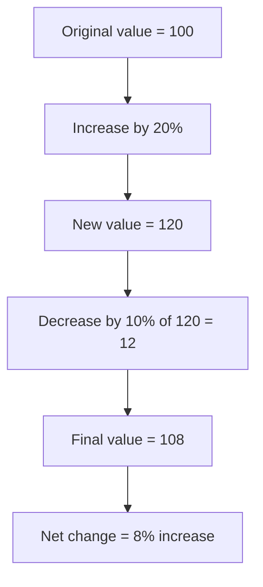
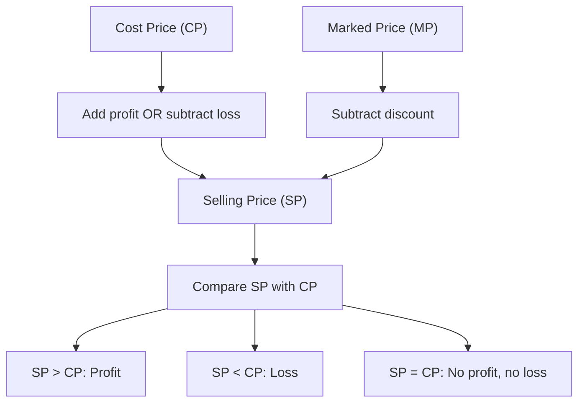
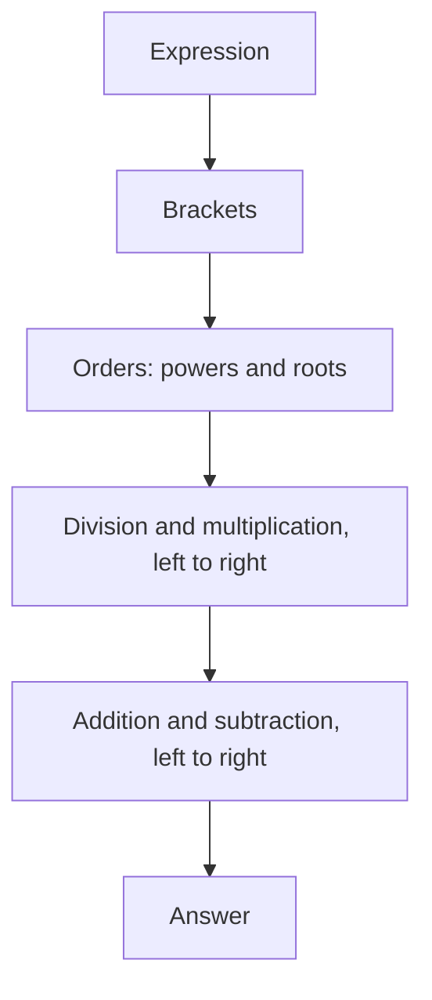
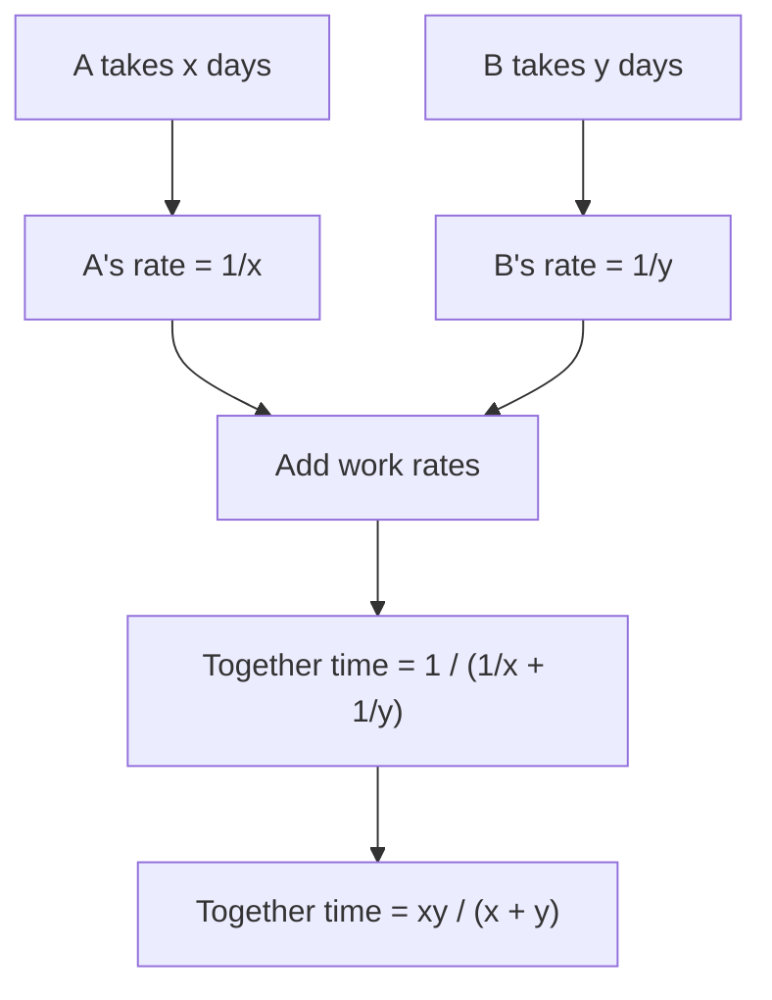
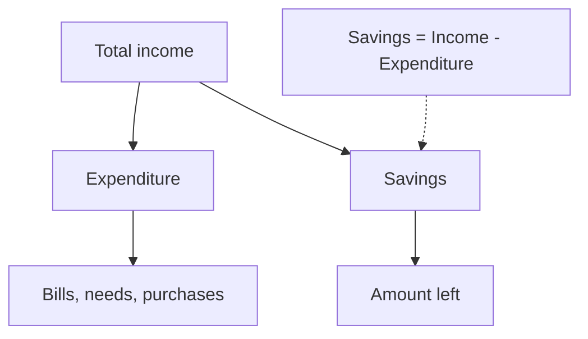
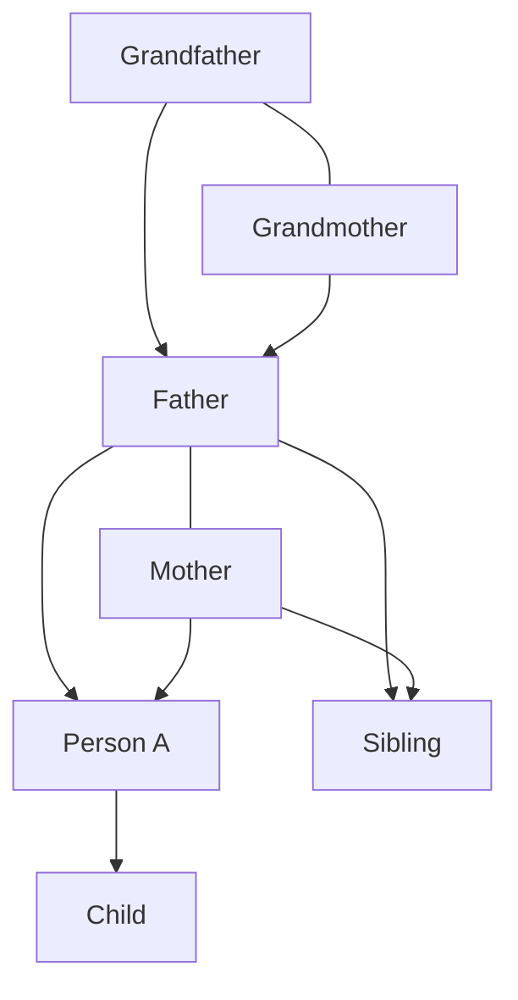
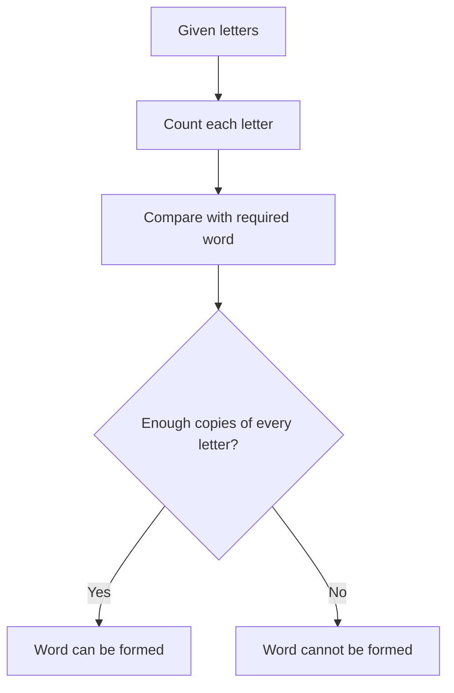
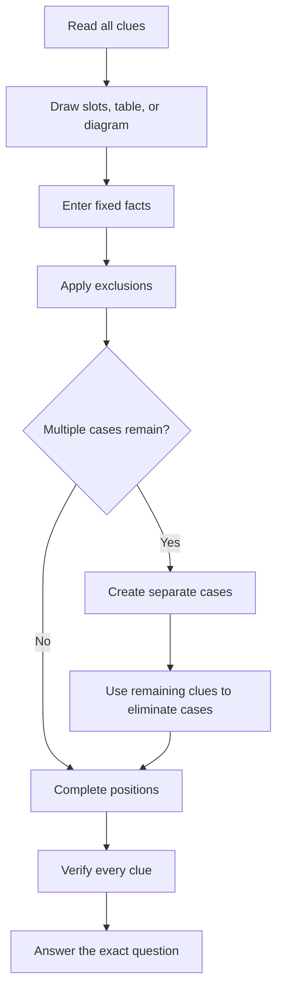

# Quantitative Aptitude & Reasoning
## Topic-wise Formula and Short-Trick Handbook

**Coverage:** 33 topics from the supplied topic list — **18 Quantitative Aptitude** and **15 Reasoning** topics.

This handbook is designed for competitive-exam revision. It collects the standard formulas, recurring patterns, shortcut methods, and checks that are useful across common question types. “All possible” tricks cannot be exhaustively listed because exam setters can combine concepts in new ways; use this as a broad, high-coverage reference and always check the conditions of a formula.

---

# Contents

## Part A — Quantitative Aptitude
1. Arithmetic – Other
2. Ratio & Proportion
3. Percentage
4. Profit & Loss
5. Simplification / Approximation
6. Data Interpretation
7. Average
8. Speed, Time & Distance
9. Quadratic Equations
10. Number Series
11. Time & Work
12. Train
13. Age
14. Mensuration
15. Income & Expenditure
16. Pipes & Cisterns
17. Partnership
18. Mixture & Alligation

## Part B — Reasoning
19. Blood Relation
20. Syllogism
21. Reasoning – Other
22. Comparison / Ranking Puzzle
23. Floor / Box Puzzle
24. Coding-Decoding
25. Day / Month / Date Puzzle
26. Inequality
27. Alphanumeric Series
28. Direction & Distance
29. Word Formation / Arrangement
30. Designation / Classification Puzzle
31. Seating Arrangement – Linear
32. Seating Arrangement – Circular
33. Seating Arrangement – Square

---

# Part A — Quantitative Aptitude

## 1. Arithmetic – Other

This is a broad category. First identify whether the question is about numbers, fractions, HCF/LCM, divisibility, remainders, or another arithmetic concept.

### 1.1 Fractions and basic identities

- `a/b + c/d = (ad + bc)/bd`
- `a/b − c/d = (ad − bc)/bd`
- `a/b × c/d = ac/bd`
- `(a/b) ÷ (c/d) = ad/bc`
- `x% of y = y% of x`.
- A fraction `a/b` as a percentage is `(a/b) × 100%`.
- To compare fractions with positive denominators, cross-multiply: compare `ad` and `bc` for `a/b` and `c/d`.
- If numerator and denominator are both multiplied or divided by the same non-zero number, the fraction's value does not change.

### 1.2 HCF and LCM

- For two positive integers: `HCF × LCM = product of the two integers`.
- Prime-factorisation method:
  - HCF: take each common prime with its **smallest** exponent.
  - LCM: take every prime with its **largest** exponent.
- For fractions in lowest terms:
  - HCF = HCF of numerators / LCM of denominators.
  - LCM = LCM of numerators / HCF of denominators.
- Greatest number that divides several numbers leaving the same remainder: find the HCF of their pairwise differences.
- Least number exactly divisible by several numbers: find their LCM.
- If two events repeat every `a` and `b` units, they coincide again after `LCM(a,b)` units, assuming they start together.

### 1.3 Divisibility tests

| Divisor | Quick test |
|---|---|
| 2 | Last digit is 0, 2, 4, 6, or 8 |
| 3 | Sum of digits is divisible by 3 |
| 4 | Number formed by the last two digits is divisible by 4 |
| 5 | Last digit is 0 or 5 |
| 6 | Divisible by both 2 and 3 |
| 8 | Number formed by the last three digits is divisible by 8 |
| 9 | Sum of digits is divisible by 9 |
| 10 | Last digit is 0 |
| 11 | Difference between the sums of alternate-position digits is 0 or a multiple of 11 |
| 12 | Divisible by both 3 and 4 |
| 25 | Last two digits are 00, 25, 50, or 75 |

### 1.4 Remainders

- Division identity: `N = dq + r`, where `0 ≤ r < d`.
- Addition: `(a+b) mod m = [(a mod m)+(b mod m)] mod m`.
- Subtraction and multiplication can similarly be reduced modulo `m`.
- For a large power, reduce the base modulo the divisor and identify the repeating remainder cycle.
- Unit-digit cycles:
  - 0, 1, 5, 6: cycle length 1.
  - 4, 9: cycle length 2.
  - 2, 3, 7, 8: cycle length 4.
- For powers of 2, 3, 7, or 8, divide the exponent by 4 and use the remainder to select the cycle position. If the remainder is 0, use the fourth position.
- For powers ending in 4 or 9, use odd/even exponent.
- For a number of the form `a^n − b^n`, factorisation may help; for example, `a²−b²=(a−b)(a+b)`.

### 1.5 Number properties and sums

- Sum of first `n` natural numbers: `n(n+1)/2`.
- Sum of first `n` even numbers: `n(n+1)`.
- Sum of first `n` odd numbers: `n²`.
- Sum of squares: `n(n+1)(2n+1)/6`.
- Sum of cubes: `[n(n+1)/2]²`.
- Sum of an arithmetic progression: `n(first term + last term)/2`.
- `1+3+5+...+(2n−1)=n²`.
- Number of factors of `N = p^a q^b r^c`: `(a+1)(b+1)(c+1)`, where `p,q,r` are distinct primes.
- A perfect square has even exponents in its prime factorisation.
- A perfect cube has exponents that are multiples of 3.
- For two numbers, product = HCF × LCM.

### 1.6 Common algebraic identities

- `(a+b)² = a² + 2ab + b²`
- `(a−b)² = a² − 2ab + b²`
- `a²−b² = (a−b)(a+b)`
- `(a+b)³ = a³+3a²b+3ab²+b³`
- `(a−b)³ = a³−3a²b+3ab²−b³`
- `a³+b³ = (a+b)(a²−ab+b²)`
- `a³−b³ = (a−b)(a²+ab+b²)`
- `(a+b+c)² = a²+b²+c²+2ab+2bc+2ca`

**Shortcut:** Before multiplying large numbers, look for common factors, difference of squares, or values close to 10, 100, or 1000.

---

## 2. Ratio & Proportion

### 2.1 Core concepts

- Ratio `a:b` means `a/b`.
- If `A:B = m:n`, put `A=km` and `B=kn`.
- If `a:b = c:d`, then `ad=bc`.
- Third proportional to `a,b`: `b²/a`.
- Fourth proportional to `a,b,c`: `bc/a`.
- Mean proportional between `a,b`: `√(ab)`.

### 2.2 Division in a ratio

If total `T` is divided in ratio `a:b`:

- First share = `Ta/(a+b)`.
- Second share = `Tb/(a+b)`.

For ratio `a:b:c`, shares are `Ta/(a+b+c)`, `Tb/(a+b+c)`, and `Tc/(a+b+c)`.

**Shortcut:** Add ratio parts first, then divide the total by the sum of parts to get one unit. Multiply by each ratio part.

### 2.3 Combining ratios

If `A:B = 2:3` and `B:C = 4:5`:

1. Make the common term `B` equal.
2. LCM of 3 and 4 is 12.
3. Scale the first ratio to `8:12` and second to `12:15`.
4. Therefore `A:B:C = 8:12:15`.

Always equalise the common quantity before combining ratios.

### 2.4 Changes in ratio

If `A:B = a:b` and `A` changes by `x` while `B` changes by `y`, use:

`new ratio = (ka ± x):(kb ± y)`

Choose `k` from any given total or difference. Do not add percentages directly to ratio terms unless the base quantities are correctly represented.

### 2.5 Direct and inverse proportion

- Direct proportion: `x/y = constant`; if `x` doubles, `y` doubles.
- Inverse proportion: `xy = constant`; if `x` doubles, `y` halves.
- Combined proportion: identify which variables increase the result and which reduce it, then form the product/division relationship.

### 2.6 Partnership link

Profit is divided in the ratio of `capital × time`, not simply capital when investment periods differ.

**Checks:** Convert units to the same unit before forming a ratio. Ratios are unitless only after compatible units are used.

---

## 3. Percentage

### 3.1 Common conversions to memorise

| Fraction | Percentage |
|---|---:|
| 1/2 | 50% |
| 1/3 | 33⅓% |
| 1/4 | 25% |
| 1/5 | 20% |
| 1/6 | 16⅔% |
| 1/8 | 12.5% |
| 1/9 | 11.11…% |
| 1/10 | 10% |
| 1/12 | 8⅓% |
| 1/16 | 6.25% |
| 1/20 | 5% |
| 1/25 | 4% |
| 1/40 | 2.5% |
| 1/50 | 2% |
| 1/100 | 1% |

### 3.2 Basic formulas

- `x% of y = xy/100`.
- Percentage = `(part/whole) × 100`.
- Percentage change = `(change/original) × 100`.
- After an increase of `p%`: `new = old × (100+p)/100`.
- After a decrease of `p%`: `new = old × (100−p)/100`.

### 3.3 Successive percentage change

Two successive changes of `a%` and `b%`:

`Net change % = a + b + ab/100`

Treat a decrease as a negative percentage.

Examples:
- +20%, then +10%: `20+10+2 = 32%` increase.
- +20%, then −10%: `20−10−2 = 8%` increase.
- +p%, then −p%: net decrease = `p²/100%`.

### 3.4 Reverse percentage

- If final value after a `p%` increase is known: original = `final × 100/(100+p)`.
- If final value after a `p%` decrease is known: original = `final × 100/(100−p)`.

### 3.5 Comparing two quantities

- If A is `x%` more than B, then B is `100x/(100+x)%` less than A.
- If A is `x%` less than B, then B is `100x/(100−x)%` more than A.
- If a value rises from `A` to `B`, percentage increase = `(B−A)/A × 100`.

### 3.6 Population, depreciation, and repeated growth

For repeated annual growth at rate `r%`:

`Final = Initial × (1+r/100)^n`

For annual depreciation at rate `r%`:

`Final = Initial × (1−r/100)^n`

### 3.7 Exam shortcuts

- `x% of y = y% of x` can simplify calculations: 16% of 25 = 25% of 16 = 4.
- For 10%, divide by 10; for 5%, take half of 10%; for 1%, divide by 100.
- For 12.5%, divide by 8; for 25%, divide by 4; for 33⅓%, divide by 3.
- When a percentage is applied to a changed base, identify the correct base before calculating.

---

## 4. Profit & Loss

### 4.1 Definitions and formulas

Let CP = cost price, SP = selling price, MP = marked/list price.

- Profit = `SP−CP`.
- Loss = `CP−SP`.
- Profit % = `(Profit/CP) × 100`.
- Loss % = `(Loss/CP) × 100`.
- `SP = CP × (100+profit%)/100`.
- `SP = CP × (100−loss%)/100`.
- `CP = SP × 100/(100+profit%)` for profit.
- `CP = SP × 100/(100−loss%)` for loss.

**Important:** Profit or loss percentage is normally calculated on CP, not SP.

### 4.2 Discount

- Discount = `MP−SP`.
- Discount % = `(Discount/MP) × 100`.
- `SP = MP × (100−discount%)/100`.
- Successive discounts `a%` and `b%`:
  - Net discount = `a+b−ab/100`.
  - Example: 20% and 10% gives `20+10−2 = 28%`.

### 4.3 Mark-up and discount together

If CP is increased by `m%` to set MP and a discount `d%` is offered:

`SP/CP = (1+m/100)(1−d/100)`

Then calculate profit or loss from `(SP−CP)/CP × 100`.

### 4.4 Same selling price, equal gain and loss

If two articles are sold at the same SP, one at `x%` gain and the other at `x%` loss, the overall result is a loss of:

`x²/100 %`

This result assumes equal selling prices.

### 4.5 False weights

If a seller charges for 1 kg but gives only `w` grams, with cost price based on 1000 g:

`Gain % = (1000−w)/w × 100`

For an additional price increase or decrease, calculate actual revenue and actual cost separately.

### 4.6 Quick checks

- Use CP as the base for profit/loss.
- Use MP as the base for discount.
- Convert each successive discount one after another; do not simply add discounts.
- If tax/GST is mentioned, identify whether it is applied before or after discount and follow the wording.

---

## 5. Simplification / Approximation

### 5.1 Order of operations

Use **BODMAS**:

1. Brackets
2. Orders/powers/roots
3. Division and multiplication, from left to right
4. Addition and subtraction, from left to right

Multiplication does not always come before division; they have equal precedence. Similarly, addition and subtraction have equal precedence.

### 5.2 Calculation shortcuts

- `a × 5 = a × 10 ÷ 2`.
- `a × 25 = a × 100 ÷ 4`.
- `a × 125 = a × 1000 ÷ 8`.
- `a × 9 = a × 10 − a`.
- `a × 99 = a × 100 − a`.
- `a × 11` for a two-digit number `ab`: write `a (a+b) b`, carrying when the middle sum is 10 or more.
- `a²` near 100: `(100±x)² = 10000 ± 200x + x²`.
- Difference of squares: `a²−b²=(a−b)(a+b)`.

### 5.3 Square and root patterns

- Numbers ending in 5: `(10a+5)² = 100a(a+1)+25`.
  - Example: 35² = 3×4 followed by 25 = 1225.
- `√(ab)` can be simplified by extracting perfect-square factors.
- Memorise squares at least from 1 to 30 and cubes from 1 to 15 for speed.
- `√(a²b) = a√b` for non-negative `a,b`.

### 5.4 Approximation

- Round numbers to convenient tens, hundreds, or decimals only when the options are sufficiently separated.
- Keep track of whether rounding makes the estimate higher or lower.
- Estimate the order of magnitude before detailed calculation.
- In division, round the divisor carefully; a small change in divisor can materially change the answer.
- Use approximation to eliminate options, not as an exact answer when options are close.

### 5.5 Fractions and decimals

- Convert recurring or familiar decimals to fractions where helpful: 0.5=1/2, 0.25=1/4, 0.125=1/8, 0.2=1/5.
- Divide by a fraction by multiplying by its reciprocal.
- Cancel common factors before multiplying to keep numbers small.

---

## 6. Data Interpretation (DI)

DI is primarily arithmetic applied to tables, bar charts, line graphs, pie charts, and caselets.

### 6.1 Core formulas

- Percentage share = `(category value/total) × 100`.
- Percentage increase/decrease = `(new−old)/old × 100`.
- Average = `sum of observations/number of observations`.
- Ratio = `value A:value B`.
- Difference = `larger value−smaller value`.
- Pie-chart angle = `(category/total) × 360°`.
- Pie-chart value = `(angle/360°) × total`.

### 6.2 Table and chart workflow

1. Read the title, units, time period, and legend.
2. Check whether the values are actual numbers, percentages, thousands, or lakhs.
3. Identify the exact row/column needed.
4. Write the required operation before calculating.
5. Estimate the answer and compare with options.

### 6.3 Fast calculation methods

- For a ratio question, simplify by dividing both values by their HCF.
- For percentage comparisons, use `difference/base × 100`; the base is the value asked about.
- For averages, use totals first. If a value is replaced, new average = old average + (change in total / number of items).
- For pie charts, use angle fractions: 90° = 1/4, 72° = 1/5, 60° = 1/6, 45° = 1/8, 36° = 1/10.
- When two categories are compared across several years, calculate differences in a small scratch table instead of repeatedly scanning the graph.

### 6.4 Common traps

- Do not confuse percentage points with percentage change.
- A rise from 20% to 30% is 10 percentage points, but a 50% relative increase.
- Do not take the wrong year's value as the base.
- Check whether a chart starts at zero; a truncated axis can exaggerate visual differences.
- In caselets, distinguish totals, subtotals, and overlapping categories.

---

## 7. Average

### 7.1 Core formulas

- Average = `sum of values / number of values`.
- Sum = `average × number of values`.
- New average after adding `x`: `(old sum+x)/(n+1)`.
- New average after removing `x`: `(old sum−x)/(n−1)`.
- New average after replacing `a` with `b`: `old average + (b−a)/n`.

### 7.2 Combined average

For groups with sizes `n1,n2` and averages `a1,a2`:

`Combined average = (n1a1+n2a2)/(n1+n2)`

Never take the simple mean of the two group averages unless the group sizes are equal.

### 7.3 Deviation shortcut

If values are near a convenient number `M`:

`Average = M + (sum of deviations from M)/n`

Example: for 48, 49, 51, 52, take M=50. Deviations are −2, −1, +1, +2; total deviation is 0, so average is 50.

### 7.4 Consecutive numbers

- Average of consecutive integers = `(first+last)/2`.
- Average of an odd count of consecutive integers is the middle integer.
- Average of an even count of consecutive integers is the mean of the two middle integers.
- Average of first `n` natural numbers = `(n+1)/2`.

### 7.5 Weighted average

`Weighted average = sum(weight × value)/sum(weights)`

Use this for different group sizes, prices, speeds over equal distances, and mixtures.

---

## 8. Speed, Time & Distance

### 8.1 Basic formulas

- `Speed = Distance/Time`.
- `Distance = Speed × Time`.
- `Time = Distance/Speed`.
- `1 km/h = 5/18 m/s`.
- `1 m/s = 18/5 km/h`.

### 8.2 Relative speed

- Opposite directions: relative speed = `u+v`.
- Same direction: relative speed = `|u−v|`.
- Time to meet = initial separation / relative speed.
- Time to overtake = initial gap / relative speed.

### 8.3 Average speed

- For equal distances at speeds `u` and `v`:
  - Average speed = `2uv/(u+v)`.
- For equal time intervals:
  - Average speed = `(u+v)/2`.
- General case: total distance / total time.

Do not use the simple arithmetic mean unless travel times are equal.

### 8.4 Boats and streams

Let boat speed in still water = `b`, stream speed = `s`.

- Downstream speed = `b+s`.
- Upstream speed = `b−s`.
- Still-water speed = `(downstream+upstream)/2`.
- Stream speed = `(downstream−upstream)/2`.

### 8.5 Circular track

For a circular track of circumference `C`:

- Opposite directions: meeting interval = `C/(u+v)`.
- Same direction: overtaking interval = `C/|u−v|`.

### 8.6 Shortcut workflow

- Convert all units first.
- If distance is fixed, speed and time are inversely proportional.
- If time is fixed, distance is directly proportional to speed.
- For a journey with multiple legs, add all distances and all times separately, then divide.

---

## 9. Quadratic Equations

### 9.1 Standard form

`ax²+bx+c=0`, where `a≠0`.

- Discriminant: `D=b²−4ac`.
- Roots: `x = [-b ± √D]/(2a)`.
- Sum of roots: `α+β = −b/a`.
- Product of roots: `αβ = c/a`.

### 9.2 Nature of roots

- `D>0`: two distinct real roots.
- `D=0`: equal real roots.
- `D<0`: no real roots.

### 9.3 Factorisation shortcut

Find two numbers whose product is `ac` and sum is `b`, split the middle term, then factor by grouping.

For monic equations `x²+bx+c=0`, find two numbers with:
- sum = `b`
- product = `c`

### 9.4 Comparing roots in exam questions

If two equations are given, solve or factor both and compare their roots.

Common notation:
- `x > y`: x is greater.
- `x < y`: x is smaller.
- `x ≥ y`: x is greater than or equal to y.
- `x ≤ y`: x is less than or equal to y.
- If the relationship cannot be fixed for all valid roots, choose “relationship cannot be established.”

**Important:** Do not compare only one root if the equation has two roots. Check both roots and all possible pairings unless the question specifies a particular root.

---

## 10. Number Series

### 10.1 Standard pattern checklist

Check in this order:

1. First differences.
2. Second differences.
3. Third differences.
4. Ratios or multiplication/division.
5. Alternating terms (odd-position and even-position series).
6. Squares, cubes, primes, and powers.
7. Difference or ratio involving consecutive natural numbers.
8. Mixed operations such as `×2+1`, `×3−2`.
9. Digit-based patterns: sum, product, reversal, or concatenation.
10. Position-based patterns such as `n²±k` or `n³±k`.

### 10.2 Common sequences

- Natural numbers: 1, 2, 3, 4, …
- Even numbers: 2, 4, 6, 8, …
- Odd numbers: 1, 3, 5, 7, …
- Squares: 1, 4, 9, 16, 25, 36, …
- Cubes: 1, 8, 27, 64, 125, …
- Primes: 2, 3, 5, 7, 11, 13, 17, …
- Fibonacci-type: each term is the sum of the previous two.

### 10.3 Difference method

Example structure:

`3, 8, 15, 24, 35, ?`

First differences: `5, 7, 9, 11`; next difference is 13, so next term is 48.

If first differences are not regular, calculate second differences.

### 10.4 Alternating series

For a series such as `2, 10, 4, 20, 6, 30, ?`, separate positions:
- Odd positions: 2, 4, 6, …
- Even positions: 10, 20, 30, …

### 10.5 Exam discipline

- Do not force an elaborate pattern when a simple one works.
- Test the proposed rule against every term.
- Check whether the missing term is in the middle, because forward and backward patterns may both help.
- For wrong-number series, identify the first term that violates the otherwise consistent rule.

---

## 11. Time & Work

### 11.1 Core formula

If a person completes a job in `x` days:

- One-day work = `1/x`.
- If A takes `x` days and B takes `y` days, combined one-day work = `1/x+1/y`.
- Together time = `xy/(x+y)`.

For three workers, add all individual work rates.

### 11.2 LCM efficiency method

This is often faster than fractions:

1. Take total work as the LCM of the individual days.
2. Efficiency = total work / days.
3. Add or subtract efficiencies.
4. Time = total work / net efficiency.

Example: A takes 12 days and B 18 days. Total work = LCM(12,18)=36 units. Efficiencies are 3 and 2 units/day. Together: 5 units/day, so time = 36/5 = 7.2 days.

### 11.3 Men, days, hours

For the same type of work and equal efficiency:

`Work ∝ persons × days × hours`

Therefore:

`M1D1H1/W1 = M2D2H2/W2`

Use this proportion only when workers have equal productivity and the work conditions remain comparable.

### 11.4 Efficiency and time

- Efficiency is inversely proportional to time for the same work.
- If A is twice as efficient as B, A takes half the time.
- If efficiency ratio is `a:b`, time ratio is `b:a`.

### 11.5 Alternate-day work

Calculate work completed over a complete cycle (for example, two days when A and B alternate). Then calculate the remaining work on the final partial cycle.

### 11.6 Wages

Wages are divided in the ratio of work done, usually `efficiency × time worked`, not simply the number of workers.

---

## 12. Train

### 12.1 Fundamental rule

For a train crossing an object:

`Time = total length to be covered / relative speed`

Convert speed to m/s when lengths are in metres.

### 12.2 Common cases

- Crossing a pole or standing person: distance = train length.
- Crossing a platform or bridge: distance = train length + platform/bridge length.
- Two trains in opposite directions: distance = sum of train lengths; relative speed = sum of speeds.
- Two trains in the same direction: distance = sum of train lengths; relative speed = difference of speeds.
- Train passing a moving person: use relative speed and the train length.

### 12.3 Unit conversion

- km/h to m/s: multiply by `5/18`.
- m/s to km/h: multiply by `18/5`.

### 12.4 Shortcut

When two crossing times are known at the same speed:
- Train length = speed × time crossing a pole.
- Platform length = speed × (platform-crossing time − pole-crossing time).

Always confirm whether the object is stationary or moving.

---

## 13. Age

### 13.1 Core setup

- Present age = `x`.
- Age after `n` years = `x+n`.
- Age `n` years ago = `x−n`.
- If A is `k` times B's age: `A=kB`.
- Difference between two people's ages remains constant.

### 13.2 Ratio method

If present ages are in ratio `a:b`, write them as `ax` and `bx`.

If after `n` years the ratio becomes `c:d`:

`(ax+n)/(bx+n) = c/d`

Cross-multiply and solve for `x`.

For a past condition, use `ax−n` and `bx−n`.

### 13.3 Average age

- Total age = average age × number of people.
- If a person joins or leaves, change the total age first, then divide by the new group size.
- If one person's age changes by `k`, group average changes by `k/n` for a group of `n`, assuming membership is unchanged.

### 13.4 Parent-child patterns

The age difference remains fixed. If a parent is currently 3 times a child's age, do not assume that ratio remains 3 after a fixed number of years.

**Shortcut:** Translate each sentence into an equation before solving. Keep “years ago” and “years later” signs consistent.

---

## 14. Mensuration

Use consistent units. Area is in square units; volume is in cubic units.

### 14.1 2D shapes

| Shape | Area | Perimeter / circumference |
|---|---|---|
| Square, side `a` | `a²` | `4a` |
| Rectangle, length `l`, breadth `b` | `lb` | `2(l+b)` |
| Triangle | `½ × base × height` | Sum of three sides |
| Equilateral triangle, side `a` | `√3a²/4` | `3a` |
| Parallelogram | `base × height` | `2(a+b)` |
| Rhombus, diagonals `d1,d2` | `½d1d2` | `4a` |
| Trapezium, parallel sides `a,b` | `½(a+b)h` | Sum of four sides |
| Circle, radius `r` | `πr²` | `2πr` |
| Semicircle | `½πr²` | `πr+2r` including diameter |

### 14.2 Triangle shortcuts

- Heron's formula: `Area = √[s(s−a)(s−b)(s−c)]`, where `s=(a+b+c)/2`.
- Right triangle: `a²+b²=c²`.
- Equilateral triangle height = `√3a/2`.
- Similar triangles: if side ratio is `k`, area ratio is `k²`.

### 14.3 Circle shortcuts

- Diameter = `2r`.
- Arc length = `(θ/360°) × 2πr`.
- Sector area = `(θ/360°) × πr²`.
- Ring area = `π(R²−r²)`.
- For similar circles, area ratio = square of radius ratio.

### 14.4 3D solids

| Solid | Volume | Curved / lateral surface area | Total surface area |
|---|---|---|---|
| Cube, side `a` | `a³` | — | `6a²` |
| Cuboid, `l,b,h` | `lbh` | — | `2(lb+bh+hl)` |
| Cylinder, radius `r`, height `h` | `πr²h` | `2πrh` | `2πr(h+r)` |
| Cone, radius `r`, height `h`, slant `l` | `⅓πr²h` | `πrl` | `πr(l+r)` |
| Sphere, radius `r` | `4/3πr³` | `4πr²` | `4πr²` |
| Hemisphere, radius `r` | `2/3πr³` | `2πr²` | `3πr²` |

For a right circular cone: `l = √(r²+h²)`.

### 14.5 Changes in dimensions

- If every length is multiplied by `k`, area is multiplied by `k²` and volume by `k³`.
- If radius doubles, circle area becomes 4 times and sphere volume becomes 8 times.
- If a cube's side doubles, surface area becomes 4 times and volume becomes 8 times.

### 14.6 Unit conversions

- `1 m = 100 cm`; `1 m² = 10,000 cm²`; `1 m³ = 1,000,000 cm³`.
- `1 litre = 1000 cm³`.
- `1 m³ = 1000 litres`.
- Use `π = 22/7` or `3.14` according to the question/options.

---

## 15. Income & Expenditure

### 15.1 Core formulas

- Savings = Income − Expenditure.
- Income = Expenditure + Savings.
- Expenditure = Income − Savings.
- Savings % of income = `(Savings/Income) × 100`.
- Expenditure % of income = `(Expenditure/Income) × 100`.
- If income is `I` and expenditure is `E`, saving ratio = `(I−E):I` as a share of income.

### 15.2 Change in income and expenditure

Let original income be `I`, expenditure `E`, and savings `S=I−E`.

If income increases by `a%` and expenditure by `b%`:

- New income = `I(1+a/100)`.
- New expenditure = `E(1+b/100)`.
- New savings = new income − new expenditure.

Do not apply the percentage change directly to savings unless the question says savings themselves change by that percentage.

### 15.3 Ratio shortcuts

If expenditure is `x%` of income:
- Savings = `(100−x)%` of income.
- Savings : expenditure = `(100−x):x`.

If savings are `x%` of income:
- Expenditure = `(100−x)%` of income.

### 15.4 Typical method

Use a convenient base such as income = 100 when only percentages are given. Calculate expenditure and savings on that base, then scale if an actual amount is provided.

---

## 16. Pipes & Cisterns

### 16.1 Work-rate model

- Filling pipe: positive rate.
- Emptying/leak pipe: negative rate.
- If a pipe fills a tank in `x` hours, rate = `1/x` tank/hour.
- If a pipe empties it in `y` hours, rate = `−1/y` tank/hour.
- Net rate = sum of all rates.
- Time = `1/net rate`, provided net rate is positive.

### 16.2 Two filling pipes

If A fills in `x` hours and B in `y` hours:

`Together time = xy/(x+y)`

### 16.3 Filling pipe plus leak

If a tap fills in `x` hours and a leak empties in `y` hours:

`Net time = xy/(y−x)`, provided `y>x`.

If `y≤x`, the tank does not fill under those conditions.

### 16.4 LCM shortcut

Take tank capacity as the LCM of the times, convert each pipe into units/hour, add filling rates and subtract emptying rates.

### 16.5 Alternate opening/closing

Calculate the net amount filled during a complete operating cycle. Repeat full cycles, then calculate the final partial cycle carefully.

---

## 17. Partnership

### 17.1 Profit-sharing formula

For partners with investments `C1,C2` and investment times `T1,T2`:

`Profit ratio = C1T1 : C2T2`

For multiple partners, calculate each partner's `capital × time` and divide profit in that ratio.

### 17.2 Changing capital

If capital changes during the year, split the year into periods:

`Capital-time value = C1×T1 + C2×T2 + ...`

Use consistent time units (months or days) for every partner.

### 17.3 Working partner

If a working partner receives a fixed salary/commission first:
1. Deduct that payment from distributable profit if the question requires it.
2. Divide the remaining profit by the capital-time ratio.

### 17.4 Shortcut and check

- Same capital, different time: profit ratio equals time ratio.
- Same time, different capital: profit ratio equals capital ratio.
- If both differ, multiply capital by time.
- The sum of partners' profit shares must equal total distributable profit.

---

## 18. Mixture & Alligation

### 18.1 Alligation rule

For two ingredients with values/concentrations `C1` and `C2`, mixed to get mean `M` (where `C1 < M < C2`):

`Quantity of lower : Quantity of higher = (C2−M):(M−C1)`

This is the alligation cross-difference rule.

### 18.2 Weighted mean

`Mean concentration = (q1C1+q2C2)/(q1+q2)`

Use fractions or percentages consistently.

### 18.3 Replacement formula

A vessel contains `V` litres. Each operation removes `x` litres and replaces it with the same amount of another liquid. After `n` operations, original liquid remaining:

`V × (1−x/V)^n`

This assumes the contents are thoroughly mixed before each removal.

### 18.4 Adding pure ingredient

If a mixture has volume `V` and concentration `c`, pure ingredient added = `x`:

`New concentration = (cV+x)/(V+x)`

Use `c` as a decimal or percentage consistently.

### 18.5 Adding water

If `V` litres of a solution has concentration `c`, adding `x` litres of water gives:

`New concentration = cV/(V+x)`

### 18.6 Common traps

- Alligation gives a **quantity ratio**, not a price ratio unless quantities/prices are the specified values.
- Keep the same unit for all quantities.
- In replacement problems, the remaining original liquid is multiplied by the remaining fraction at every operation.

---

# Part B — Reasoning

## 19. Blood Relation

### 19.1 Family-tree method

Draw a small family tree instead of solving a long sentence mentally.

Common notation:
- Use one row for the same generation.
- Put parents one level above children.
- Connect spouses horizontally.
- Mark male/female only when explicitly stated.
- Keep the point of view of the person named in the question.

### 19.2 Generation levels

- Grandparent: +2 generations.
- Parent / uncle / aunt: +1 generation.
- Self / sibling / spouse / cousin: same generation.
- Child / nephew / niece: −1 generation.
- Grandchild: −2 generations.

Generation level alone does not distinguish sibling, cousin, spouse, or in-law; use the actual family links.

### 19.3 Translation shortcuts

- “A is the son of B”: A is one generation below B; A is male.
- “A is the daughter of B”: A is one generation below B; A is female.
- “A is the brother of B”: same generation; A is male.
- “A is the mother of B”: A is one generation above B; A is female.
- “Only son/daughter”: use the exclusivity exactly as stated.
- “Maternal” refers to the mother's side; “paternal” to the father's side.

### 19.4 Coded relations

If symbols represent relations, first translate each symbol into a clear sentence or a parent-child/spouse link. Resolve the expression from inside outward, respecting brackets and direction.

### 19.5 Final check

Ask: “How is the person at the end related to the person named in the question?” Reverse the viewpoint if necessary. For example, if A is B's father, B is A's son/daughter; do not report the relation in the opposite direction.

---

## 20. Syllogism

### 20.1 Standard statements

- All A are B: A is fully inside B.
- No A is B: A and B do not overlap.
- Some A are B: A and B overlap at least partly.
- Some A are not B: at least part of A lies outside B.

Use Venn diagrams for the safest interpretation.

### 20.2 Valid conclusion patterns

- From “All A are B” and “All B are C”, conclude “All A are C”.
- From “No A is B” and “All C are A”, conclude “No C is B”.
- From “Some A are B”, it follows that “Some B are A”.
- From “No A is B”, conclude “No B is A”.
- “All A are B” does **not** mean “All B are A”.
- “Some A are B” does not prove that all A or all B overlap.

### 20.3 Possibility questions

A possibility conclusion is valid if it can be drawn without contradicting the given statements.

- “All A may be B” can be possible unless the statements force some A outside B.
- “Some A may be B” is possible unless the statements establish that A and B cannot overlap.
- If “No A is B” is given, A and B cannot overlap.

### 20.4 Either-or conclusions

In standard exam formats, an either-or pair is considered when:
- The two conclusions are complementary possibilities about the same terms.
- Neither conclusion individually follows.
- One of the two must be true under the given statements.

Do not declare either-or just because two conclusions look opposite. Check the exact logical complement and the exam's convention.

### 20.5 Quantifier discipline

- “All” is not reversible.
- “Some” means at least one.
- “Some not” is not the same as “No”.
- Avoid importing real-world knowledge; use only the given statements.

---

## 21. Reasoning – Other

This is a mixed category. Identify the question family before choosing a method.

### 21.1 Analogy

Find the exact relationship between the first pair, then apply it to the second pair.

Common relationships:
- Part to whole.
- Tool to function.
- Worker to workplace.
- Cause to effect.
- Synonym / antonym.
- Number operation or positional relationship.

### 21.2 Classification / odd one out

Compare items by one consistent feature:
- Category or meaning.
- Letter count, alphabet positions, vowels/consonants.
- Number of factors, parity, prime/composite status.
- Square/cube relationship.
- Shape, symmetry, sides, angles.

The odd item should be the one that breaks the strongest common rule.

### 21.3 Logical sequence

Look for natural order, process order, size, age, stage, or chronology. Write the order explicitly before selecting an option.

### 21.4 Statement and conclusion

- A conclusion must follow from the statement, not merely be likely.
- Separate facts from assumptions.
- Do not use external knowledge unless the question asks for it.
- “May be true” is not the same as “must be true.”

### 21.5 Cause and effect

Check whether the two events are causally connected, merely correlated, or independent. Watch for a third factor that could explain both.

### 21.6 Input-output / machine arrangement

- Compare each step with the previous step.
- Identify whether one number/word is fixed at each step.
- Check sorting order, swapping, ranking, and alternating operations.
- Once the rule is known, predict the next step rather than re-solving the entire sequence.

### 21.7 General strategy

Classify first, test the simplest consistent rule, and reject any rule that does not explain every given element.

---

## 22. Comparison / Ranking Puzzle

### 22.1 Rank from top and bottom

If total number of people is `N`:
- Rank from bottom = `N − rank from top + 1`.
- Rank from top = `N − rank from bottom + 1`.
- Total people = `rank from top + rank from bottom − 1`.

### 22.2 People between two ranks

- If A and B have ranks `r1` and `r2` from the same end, number between = `|r1−r2|−1`.
- If ranks are from opposite ends, convert both to the same end first.

### 22.3 Interchanging positions

If A and B exchange positions:
- The new rank of A is B's old rank.
- The new rank of B is A's old rank.
- Use the given rank change to form an equation.

### 22.4 Comparison symbols

Translate every statement into a consistent chain:
- A taller than B: `A>B`.
- A not shorter than B: `A≥B`.
- A is between B and C: determine whether the order is `B>A>C` or `C>A>B` from the wording.

### 22.5 Puzzle table method

Make one row per person and columns for attributes (rank, height, score, age, etc.). Fill direct clues first, then derive constraints. Mark uncertain candidates separately rather than guessing.

### 22.6 Common traps

- “Third from the top” is not the same as “three people above”.
- When counting people, include the person whose rank is given.
- “A is ahead of B” does not establish how many positions separate them.

---

## 23. Floor / Box Puzzle

### 23.1 Floor puzzle setup

Create a vertical list of floors, e.g. top to bottom:

`7, 6, 5, 4, 3, 2, 1`

Write one person per floor unless the question states otherwise.

### 23.2 Translation of clues

- “A lives above B”: A's floor number is greater if numbering increases upward.
- “A lives immediately above B”: floors differ by exactly 1.
- “Two floors between A and B”: floor difference is 3.
- “A is not on an odd floor”: restrict A to even floors.
- “A lives on an even-numbered floor”: remove all odd options.

Be consistent about whether floor 1 is the bottom or top.

### 23.3 Box stacking

Represent positions from top to bottom. Translate:
- Immediately above/below = adjacent positions.
- Two boxes between = position difference 3.
- At least one box between = not adjacent.
- Topmost/bottommost = fixed endpoint.

### 23.4 Efficient solving

1. List all positions.
2. Place fixed endpoints and immediate pairs.
3. Apply negative clues to eliminate positions.
4. Use linked attributes (person, colour, subject, box label) in separate columns.
5. Check every clue after completing the arrangement.

### 23.5 Avoiding errors

Do not assume “above” means immediately above. Do not assume a floor or box position is unique unless the puzzle says so. Keep candidate cases separate when a clue does not determine one arrangement.

---

## 24. Coding-Decoding

### 24.1 Alphabet positions

Memorise:

`A=1, B=2, C=3, …, Z=26`

Reverse positions:

`A=26, B=25, …, Z=1`

Useful pairs:
- A–Z, B–Y, C–X, D–W, …
- Position of reverse letter = `27 − original position`.

### 24.2 Common coding rules

- Forward shift: each letter moves `+k`.
- Backward shift: each letter moves `−k`.
- Alternating shifts: `+1, −1, +2, −2`, etc.
- Reverse the word.
- Reverse alphabet substitution.
- Rearrange letters by position.
- Replace letters with their alphabet numbers.
- Combine letter position with a fixed number or word length.

### 24.3 Caesar-shift method

For a shift of `k`:
- Encode: new position = `((old position−1+k) mod 26)+1`.
- Decode: use the same formula with `−k`.

This handles wrap-around from Z to A.

### 24.4 Word coding

Compare words that share letters:
1. Find repeated letters and repeated code symbols.
2. Match common letters with common code elements.
3. Check order: code may preserve or reverse the original order.
4. Test the rule on every example.

### 24.5 Number coding

Check:
- Sum of letter positions.
- Product of positions.
- Difference between positions.
- First/last letter positions.
- Word length, vowel count, consonant count.
- Position-based weights such as `1×first + 2×second`.

### 24.6 Quick tip

Write alphabet positions above the word. This avoids repeated mental counting and reduces off-by-one mistakes.

---

## 25. Day / Month / Date Puzzle

### 25.1 Odd days

An odd day is the remainder after dividing a number of days by 7.

- 1 ordinary year = 365 days = 1 odd day.
- 1 leap year = 366 days = 2 odd days.
- 7 days = 0 odd days.
- 100 years in the Gregorian calendar contain 5 odd days.
- 200 years contain 3 odd days.
- 300 years contain 1 odd day.
- 400 years contain 0 odd days.

### 25.2 Leap-year rule

A year is a leap year if:
- It is divisible by 400; or
- It is divisible by 4 but not by 100.

Thus 2000 was a leap year; 1900 was not.

### 25.3 Month lengths

- 31 days: January, March, May, July, August, October, December.
- 30 days: April, June, September, November.
- February: 28 days in an ordinary year, 29 in a leap year.

### 25.4 Day shift

- After `n` days, weekday shifts by `n mod 7`.
- For a date `n` days later, add the remainder modulo 7.
- For dates in the same year, count the days between them and take modulo 7.

### 25.5 Gregorian calendar calculation (Zeller's congruence)

For a date `q` in month `m`:
- Treat March as 3, …, December as 12.
- Treat January as month 13 and February as month 14 of the **previous** year.
- Let `K` = year within the century; `J` = zero-based century (`year // 100`).
- Compute:

`h = [q + floor(13(m+1)/5) + K + floor(K/4) + floor(J/4) + 5J] mod 7`

Mapping:
- 0 = Saturday
- 1 = Sunday
- 2 = Monday
- 3 = Tuesday
- 4 = Wednesday
- 5 = Thursday
- 6 = Friday

### 25.6 Calendar puzzle technique

- Mark the year as leap or ordinary.
- Record each month’s number of days.
- Convert day gaps into odd days.
- For a sequence of events, track weekday shifts modulo 7.
- Check whether the question uses inclusive or exclusive counting.

---

## 26. Inequality

### 26.1 Basic symbols

- `A>B`: A is greater than B.
- `A<B`: A is less than B.
- `A≥B`: A is greater than or equal to B.
- `A≤B`: A is less than or equal to B.
- `A=B`: A equals B.

### 26.2 Chain method

If `A>B>C`, then:
- A>B follows.
- A>C follows.
- B<C is false.
- A and C are comparable.

If `A>B` and `C>B`, the relation between A and C cannot be determined.

### 26.3 Reversing signs

- If `A>B`, then `B<A`.
- If `A≥B`, then `B≤A`.
- Reverse the order and reverse the inequality sign.

### 26.4 Combining statements

- `A>B` and `B≥C` imply `A>C`.
- `A≥B` and `B≥C` imply `A≥C`.
- `A>B` and `B<C` do not establish a relation between A and C.
- Equality can make a strict inequality non-strict when combining chains; preserve the strongest valid relation.

### 26.5 Coded inequalities

First replace each code symbol with its actual meaning. Then solve as an ordinary inequality chain. Do not infer a relation across a break in the chain.

### 26.6 Quick answer test

For each proposed conclusion:
1. Check whether it is true in every arrangement satisfying the statements.
2. If one valid counterexample exists, the conclusion does not follow.
3. If neither direction is fixed, choose “cannot be determined” where offered.

---

## 27. Alphanumeric Series

### 27.1 Alphabet position

Use `A=1` to `Z=26`. Reverse position is `27−normal position`.

### 27.2 Series scan

For a mixed series:
- Number the positions.
- Separate letters, digits, and symbols.
- Check the pattern within each group.
- Check whether the groups alternate.
- Check whether letters move forward/backward by a fixed or changing number.
- Check whether digits form arithmetic, geometric, square, or prime sequences.

### 27.3 Position-based questions

For a series of length `N`:
- Position from right = `N−position from left+1`.
- If asked for the element `k` places to the right/left, count positions carefully and respect the series endpoints.
- In “between” questions, count only elements strictly between the two specified positions.

### 27.4 Vowels and consonants

Vowels: A, E, I, O, U. All other alphabet letters are consonants.

When asked to rearrange letters alphabetically:
- Sort letters in ascending order.
- Preserve repeated letters unless instructed to remove duplicates.
- For reverse alphabetical order, sort descending.

### 27.5 Common traps

- Symbols may count as elements in position questions.
- A digit such as `10` may be one number or two characters, depending on the displayed series.
- Confirm whether the question refers to letters only or all characters.

---

## 28. Direction & Distance

### 28.1 Direction map

- North: up.
- South: down.
- East: right.
- West: left.
- Right turn from North → East; from East → South; from South → West; from West → North.
- Left turn is the reverse sequence.

### 28.2 Coordinate method

Take:
- East = `+x`, West = `−x`.
- North = `+y`, South = `−y`.

Add all horizontal movements to get net `x`, and all vertical movements to get net `y`.

Shortest distance from start to end:

`√(x²+y²)`

### 28.3 Pythagorean triples to memorise

- 3–4–5
- 5–12–13
- 8–15–17
- 7–24–25
- 9–40–41

Multiples of these triples also work.

### 28.4 Turns

A right turn is 90° clockwise; a left turn is 90° anticlockwise. A 180° turn reverses direction. Track the person's facing direction after every turn.

### 28.5 Relative direction

Compare the final coordinates:
- `(+,+)` = North-East.
- `(−,+)` = North-West.
- `(+,-)` = South-East.
- `(−,-)` = South-West.
- If one coordinate is zero, the final direction is purely horizontal or vertical.

### 28.6 Shortcut

Draw a rough coordinate path. Do not try to visualise a long route mentally. The shortest distance is not necessarily the total distance walked.

---

## 29. Word Formation / Arrangement

### 29.1 Word formation

Given a set of letters:
1. Count the frequency of each letter.
2. A target word is possible only if it does not require more copies of any letter than supplied.
3. Ignore letter order unless the question explicitly requires consecutive or fixed-order letters.
4. Use each letter only as many times as it appears.

### 29.2 Number of arrangements

If all `n` letters are distinct:

`Number of arrangements = n!`

If there are repeated letters with counts `p,q,r,...`:

`Arrangements = n!/(p!q!r!...)`

### 29.3 Arrangements with restrictions

- A and B together: treat AB as one block; multiply by 2 if AB and BA are both allowed.
- A and B not together = total arrangements − arrangements with A and B together.
- Fixed first/last positions: place those letters first, then arrange the remaining letters.
- Circular arrangements of `n` distinct objects: `(n−1)!`, when rotations are considered identical.

### 29.4 Alphabetical arrangement

Arrange letters by alphabet position. For repeated letters, preserve their multiplicity. To find a word from selected letters, compare letter counts rather than only checking whether each letter appears.

### 29.5 Word-position questions

If a word is formed by alphabetically arranging its letters:
- Find the required letter's sorted position.
- Account for repeated letters.
- Do not treat repeated copies as distinct unless the question asks for distinct arrangements.

---

## 30. Designation / Classification Puzzle

These puzzles assign people to roles, departments, ranks, cities, subjects, or categories.

### 30.1 Grid method

Create a table:
- Rows = people.
- Columns = designations or categories.
- Mark `✓` for confirmed assignments.
- Mark `×` for impossible assignments.
- If each person has exactly one unique designation, each row and column should contain exactly one `✓`.

### 30.2 Apply constraints

- “A is senior to B”: create an order constraint.
- “A is not manager”: eliminate the manager column for A.
- “Neither A nor B is in sales”: eliminate sales for both.
- “The doctor is from Jaipur”: link designation and city.
- “A is either the analyst or the manager”: retain both possibilities until another clue resolves them.

### 30.3 Ranking hierarchy

If designations have a fixed hierarchy, write it once from highest to lowest. Translate “senior/junior”, “above/below”, and “immediately higher/lower” into position constraints.

### 30.4 Efficient solving sequence

1. Place direct positive clues.
2. Apply exclusions.
3. Handle “either/or” clues as separate cases if necessary.
4. Connect attributes across categories.
5. Check uniqueness and every clue at the end.

### 30.5 Important caution

Do not assume that every category is unique or that every person has exactly one category unless the question establishes that condition.

---

## 31. Seating Arrangement — Linear

### 31.1 Fix the reference direction

For people facing North:
- Their left is the observer's left.
- Their right is the observer's right.

For people facing South:
- Their left and right are reversed from the observer's view.

Always draw the row and mark the facing direction before placing anyone.

### 31.2 Position notation

For `N` seats, number positions from left to right as `1` to `N`.

- Immediate left/right = one position away, from the person's perspective.
- Second to the left/right = two positions away.
- `k` people between A and B means their position difference is `k+1`.

### 31.3 Opposite-facing groups

When people face opposite directions, use each person's own perspective:
- If A faces North, A's left is west/left on the page.
- If B faces South, B's left is east/right on the page.

A small arrow beside every person helps avoid reversal errors.

### 31.4 Solving workflow

1. Draw the required number of seat slots.
2. Place fixed end positions and immediate-neighbour clues.
3. Apply negative clues.
4. Keep multiple cases when the arrangement is not uniquely determined.
5. Use remaining clues to eliminate cases.
6. Recheck all clues from each person's perspective.

### 31.5 Common traps

- “A is left of B” is not necessarily “immediately left”.
- “Two people sit between” means a position gap of three.
- Do not switch viewing direction midway through the puzzle.

---

## 32. Seating Arrangement — Circular

### 32.1 Fix one person

For a circular arrangement, fix one person at the top to remove rotational duplicates. This does not change relative seating.

### 32.2 Facing the centre

When all face the centre:
- A person's left is clockwise.
- A person's right is anticlockwise.

### 32.3 Facing outside

When all face outside:
- A person's left is anticlockwise.
- A person's right is clockwise.

### 32.4 Opposite positions

For an even number `N` of people, the person opposite a position is `N/2` seats away.

Example: with 8 people, opposite position is 4 seats away.

### 32.5 Solving workflow

1. Fix one reference person.
2. Place direct neighbour/opposite clues.
3. Apply left/right rules based on centre/outside orientation.
4. Keep cases for uncertain placements.
5. Verify each clue around the circle.

### 32.6 Common traps

- Clockwise/anticlockwise left-right rules reverse when people face outside.
- “Second to the left” means two seats away, with one person in between.
- Rotation does not create a new circular arrangement; reflection may create a different arrangement unless the question treats mirror images as equivalent.

---

## 33. Seating Arrangement — Square

### 33.1 Draw the four sides

Draw a square with the same number of seat slots on every side if the question says the seating is equally distributed. Label each side before placing people:
- Top side
- Right side
- Bottom side
- Left side

Do not assume equal numbers per side unless specified.

### 33.2 Facing directions

For people seated around the outside of a square:
- People on opposite sides may face different directions.
- Determine each person's left and right from their own facing direction, not from the page.

Write a small arrow for every person or side.

### 33.3 Corner and side positions

Separate:
- Corner seats.
- Middle seats on each side.

A corner person's immediate neighbours are on the two adjoining sides. A side-middle person's immediate neighbours are the adjacent positions on that same side.

### 33.4 Opposite positions

For a symmetrical square arrangement, identify the actual seat opposite across the centre. Do not assume that “opposite” always means the same side label when the number of seats per side is not stated.

### 33.5 Solving workflow

1. Draw the exact number of positions.
2. Mark corners and side-middle positions.
3. Fix a reference person or a fixed clue.
4. Translate every left/right clue using the person's facing direction.
5. Place immediate neighbours and opposite pairs.
6. Test remaining cases against all clues.

### 33.6 Common traps

- Confusing the observer's left/right with the seated person's left/right.
- Assuming a person at a corner has the same neighbour relationship as a person in the middle of a side.
- Drawing a generic four-seat square when the puzzle has more positions.

---

# Final Revision Toolkit

## A. Formulas worth memorising first

| Topic | Must-know formula |
|---|---|
| Percentage | `Percentage = part/whole × 100` |
| Successive percentage | `a+b+ab/100` (use signed values) |
| Profit | `Profit% = profit/CP × 100` |
| Discount | `Discount% = discount/MP × 100` |
| Ratio division | `Share = total × part/sum of parts` |
| Average | `Sum/count` |
| Speed | `Distance/time` |
| Equal-distance average speed | `2uv/(u+v)` |
| Work | `1/time` as a rate |
| Together work | Add work rates |
| Partnership | `Capital × time` |
| Alligation | Lower : Higher = `(Higher−Mean):(Mean−Lower)` |
| Replacement | `V(1−x/V)^n` |
| Quadratic roots | `[-b ± √(b²−4ac)]/(2a)` |
| Circle area | `πr²` |
| Cylinder volume | `πr²h` |
| Cube volume | `a³` |
| Ranking | `Top rank + bottom rank − 1 = total` |
| Direction distance | `√(x²+y²)` |

## B. Fast exam-solving checklist

1. Read the exact wording; identify what is asked.
2. Write the base quantity and units before using a formula.
3. Prefer a ratio, table, number line, family tree, or diagram when the question has multiple relationships.
4. Use LCM efficiency for work and pipes questions.
5. Use total distance ÷ total time for multi-leg average-speed questions.
6. For puzzles, record direct clues first and keep uncertain cases separate.
7. Eliminate impossible options early, but verify the selected option against every clue.
8. Estimate before long calculations to catch arithmetic mistakes.
9. Avoid rounding when answer options are close.
10. Review errors by concept: calculation error, wrong base, wrong direction, missed condition, or incorrect inference.

## C. Recommended practice order

**Quant foundation:** Simplification → Percentage → Ratio & Proportion → Average → Profit & Loss → Arithmetic Other.

**Quant application:** Time & Work → Pipes & Cisterns → Speed, Time & Distance → Train → Mixture & Alligation → Partnership → Income & Expenditure → Age → Mensuration.

**Quant exam sets:** Number Series → Quadratic Equations → Data Interpretation.

**Reasoning foundation:** Inequality → Syllogism → Blood Relation → Direction & Distance → Coding-Decoding → Alphanumeric Series.

**Reasoning puzzles:** Ranking → Floor/Box → Designation/Classification → Day/Month/Date → Linear Seating → Circular Seating → Square Seating.

**Note:** The best shortcut is the one that is both fast and reliable. Learn the underlying method first, then practise the shortcut until it becomes automatic.


---

# Visual Figures & Illustrations

These figures are embedded in this single Markdown file. Mermaid diagrams render in compatible Markdown viewers such as GitHub, GitLab, and Obsidian. Plain-text sketches remain readable in any editor.

## 1. Ratio — dividing a total

For a total `T` divided in the ratio `2:3`, there are five equal units.

```text
Total T
┌─────────┬─────────┬─────────┬─────────┬─────────┐
│    A    │    A    │    B    │    B    │    B    │
└─────────┴─────────┴─────────┴─────────┴─────────┘
     2 units for A             3 units for B

A's share = 2T/5             B's share = 3T/5
```

## 2. Percentage — successive changes



The second percentage is calculated on the changed value. Use signed values in `a + b + ab/100`.

## 3. Profit, loss, and discount — price relationship



Profit/loss percentage uses CP as its base. Discount percentage uses MP as its base.

## 4. Simplification — BODMAS



Division and multiplication have equal precedence. Addition and subtraction have equal precedence.

## 5. Data Interpretation — pie-chart geometry

```text
                 Whole circle = 360°
                  .-----------.
               .-'             '-.
             .'        25%          '.
            /          = 90°          \
           |                           |
           |        Remaining          |
            \           75%           /
             '.                     .'
               '-._____________.-'
```

`Sector angle = (category value / total) × 360°`.

## 6. Average — deviation method

```text
Values:          48       49       51       52
Assumed mean:    50       50       50       50
Deviations:      -2       -1       +1       +2

Sum of deviations = 0
Average = 50 + (0 / 4) = 50
```

Use a convenient assumed mean when values are close together.

## 7. Speed, time, and distance — formula triangle

```text
                 DISTANCE
                ----------
                SPEED × TIME

Distance = Speed × Time
Speed    = Distance ÷ Time
Time     = Distance ÷ Speed
```

```text
Opposite directions:       Same direction:

A  ----->       <----- B    A  ----->  -----> B
Relative speed = u + v     Relative speed = |u - v|
```

## 8. Quadratic equations — roots on a number line

```text
x-axis
────────────────●────────────────●──────────────
                α                β
             smaller           larger

For ax² + bx + c = 0:
Sum of roots     α + β = -b/a
Product of roots α × β = c/a
```

This is only an illustration; roots may be equal or non-real depending on the discriminant.

## 9. Time & Work — rate model



```text
Illustrative daily efficiency:
A: 3 units/day   ███
B: 2 units/day   ██
Together         █████  = 5 units/day
```

## 10. Train — crossing a platform

```text
        Train length L                         Platform length P
   ┌──────────────────────┐              ┌────────────────────────┐
   │        TRAIN         │  --------->  │        PLATFORM         │
   └──────────────────────┘              └────────────────────────┘

Distance from first entry until fully clear = L + P
Time = (L + P) / speed
```

For a pole, the object has zero length, so distance = train length.

## 11. Age — timeline

```text
Past                         Present                         Future
  │                              │                              │
  ├──────── n years ─────────────┤──────────── n years ─────────┤
  x - n                           x                              x + n

Age difference between two people remains constant.
```

## 12. Mensuration — common 2D shapes

```text
SQUARE                RECTANGLE               TRIANGLE
┌────────┐            ┌────────────┐               /\
│        │            │            │              /  \
│        │ a          │            │             /    \
└────────┘            └────────────┘            /______\
 side a                     l × b                 base b

CIRCLE
       .-''''-.
    .'    r    '.
   /      •------\
   \             /
    '.         .'
      '-.___.-'

Square area = a²       Rectangle area = l×b
Triangle area = 1/2 bh Circle area = πr²
```

## 13. Mensuration — common 3D solids

```text
CUBE                    CUBOID                    CYLINDER
     +------+              +----------+             ______
    /      /|             /          /|           /      \
   +------+ |            +----------+ |          |        |
   |      | +            |          | +          |        | h
   |      |/             |          |/            \______/
   +------+              +----------+                r

Cube volume = a³
Cuboid volume = lbh
Cylinder volume = πr²h
```

## 14. Income & Expenditure — money flow



## 15. Pipes & Cisterns — filling and emptying

```text
        Filling pipe (+)                   Emptying pipe (-)
               ↓                                  ↑
             ┌───┐                              ┌───┐
             │   │                              │   │
             └─┬─┘                              └─┬─┘
               │        ┌─────────────────┐       │
               └───────>│       TANK      │<──────┘
                        │      WATER      │
                        └─────────────────┘

Net rate = sum of filling rates - sum of emptying rates
Time = capacity / positive net rate
```

## 16. Partnership — capital multiplied by time

```text
Partner A                         Partner B
Capital = 10,000                  Capital = 15,000
Time = 12 months                  Time = 8 months

A's capital-time = 10,000 × 12 = 120,000
B's capital-time = 15,000 × 8  = 120,000

Profit ratio = 1 : 1
```

The figures are illustrative; substitute the investments and periods from the question.

## 17. Mixture & Alligation — cross-difference

```text
Lower concentration (L)                    Higher concentration (H)
          \                                         /
           \                                       /
            \                                     /
                          Mean (M)
            /                                     \
           /                                       \
          /                                         \

Quantity of lower : Quantity of higher
       = (H - M) : (M - L)
```

Example: mix 20% and 50% solutions to obtain 30%.

```text
Lower = 20%             Higher = 50%
             \         /
               Mean 30%
             /         \

Lower quantity : Higher quantity
       = (50 - 30) : (30 - 20)
       = 20 : 10
       = 2 : 1
```

## 18. Blood Relation — family tree



Draw only relationships established by the clues. Do not assume relationships that are not stated.

## 19. Syllogism — set relationships

```text
ALL A ARE B                    NO A IS B

     __________                  _______     _______
    /   _____  \                /   A   \   /   B   \
   /   /  A  \  \              /_________\ /_________\
  |   |_______|  |
   \            /
    \__________/

A is completely inside B.      A and B do not overlap.
```

```text
SOME A ARE B

       _________
      /         \
     /   A   ___\____
    |       /   B    \
    |       \________/
     \_______________/

The overlap represents at least one shared member.
```

The shapes are conceptual and not to scale.

## 20. Ranking — top and bottom

```text
TOP
 1  ── Person A
 2
 3
 4
 5
 6  ── Person B
BOTTOM

Total people = rank from top + rank from bottom - 1
```

## 21. Floor / Box puzzle — positions

```text
TOP       Floor 7   ┌───────────────┐
                    │ Person / Box  │
          Floor 6   ├───────────────┤
                    │ Person / Box  │
          Floor 5   ├───────────────┤
                    │ Person / Box  │
          Floor 4   ├───────────────┤
                    │ Person / Box  │
          Floor 3   ├───────────────┤
                    │ Person / Box  │
          Floor 2   ├───────────────┤
                    │ Person / Box  │
BOTTOM    Floor 1   └───────────────┘
```

Redraw the exact number of positions in the question. “Immediately above” means adjacent; “above” alone does not.

## 22. Coding-Decoding — alphabet positions

```text
A  B  C  D  E  F  G  H  I  J  K  L  M
1  2  3  4  5  6  7  8  9 10 11 12 13

N  O  P  Q  R  S  T  U  V  W  X  Y  Z
14 15 16 17 18 19 20 21 22 23 24 25 26

Reverse pairs:
A ↔ Z    B ↔ Y    C ↔ X    D ↔ W

Reverse-letter position = 27 - original position.
```

## 23. Day / Month / Date — weekday cycle

```text
SUN → MON → TUE → WED → THU → FRI → SAT
 ↑                                      │
 └──────────────────────────────────────┘

After n days, weekday shift = n mod 7.
```

Gregorian leap year: divisible by 400, or divisible by 4 but not by 100.

## 24. Inequality — comparison chain

```text
A > B > C

C ---------------- B ---------------- A
smaller                               larger

A > B and C > B:
Both A and C are above B, but A vs C is not determined.
```

## 25. Alphanumeric Series — separate the streams

```text
Example: A  3  C  6  E  9  G  12

Letters: A → C → E → G   (move +2 positions)
Numbers: 3 → 6 → 9 → 12  (add 3)

Number each position, then inspect letters, digits, and symbols separately.
```

## 26. Word Formation — letter-count check



For distinct arrangements with repeated letters: `n! / (p! q! r! ...)`.

## 27. Designation / Classification — deduction grid

Example layout only:

| Person | Manager | Analyst | Clerk |
|---|:---:|:---:|:---:|
| A | ✓ | × | × |
| B | × | ✓ | × |
| C | × | × | ✓ |

Mark a cell only when a clue proves it or rules it out. Do not assume all categories are unique unless the question says so.

## 28. Linear seating — everyone facing North

```text
Observer's view; everyone faces North (↑)

LEFT                                                  RIGHT
 1        2        3        4        5        6
┌────┐  ┌────┐  ┌────┐  ┌────┐  ┌────┐  ┌────┐
│ A ↑│  │ B ↑│  │ C ↑│  │ D ↑│  │ E ↑│  │ F ↑│
└────┘  └────┘  └────┘  └────┘  └────┘  └────┘

Facing North: person's left/right matches observer's left/right.
Facing South: person's left/right is reversed.
```

## 29. Circular seating — facing centre or outside

```text
                 A
            F         B
          E      ○      C
                 D

When facing CENTRE:
left = clockwise; right = anticlockwise.

When facing OUTSIDE:
left = anticlockwise; right = clockwise.
```

Fix one reference person to avoid duplicate rotations.

## 30. Square seating — corners and sides

```text
                         TOP SIDE
                 [1]      [2]      [3]
              ┌─────────────────────────┐
 LEFT SIDE    │                         │    RIGHT SIDE
    [12]      │                         │      [4]
    [11]      │                         │      [5]
    [10]      │                         │      [6]
              └─────────────────────────┘
                 [9]      [8]      [7]
                        BOTTOM SIDE

Illustrative 12-seat square. Use the actual number of seats in the question.
Mark facing directions before applying left/right clues.
```

## 31. General puzzle-solving workflow



## Figure-use notes

- Diagrams are explanatory; use the exact values and conditions in each exam question.
- For direction and seating questions, mark every person's facing direction.
- For mathematical questions, use the formula in the relevant topic section for exact calculations.
- Mermaid rendering depends on the Markdown viewer. Text sketches remain visible even if Mermaid is not supported.
